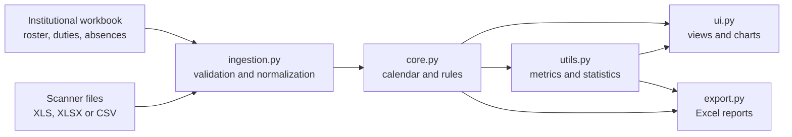

# SGAM · Medical Attendance Management System

**From biometric records to an auditable attendance calendar.** SGAM is a Windows desktop application that reconciles intern and resident rosters, duty schedules and recorded absences with check-in/check-out reports. It normalizes heterogeneous files, applies explicit daily rules and produces views and Excel reports for administrative review.

**Version 2.3.4** · Python · CustomTkinter · pandas · openpyxl · Matplotlib

**Authors:** Alan Jiménez and Fabrizzio Ramírez · [Documentación en español](README.md)

> SGAM processes local files. It does not connect directly to biometric devices or replace human review of attendance and payroll decisions.

## What it does

| Need | Implementation |
| --- | --- |
| Combine separate sources | Normalizes IDs, dates and punches from an Excel roster, `.xls`/`.xlsx` reports and generic CSV files. |
| Explain each result | Applies absences, A–D duty shifts, post-duty days, holidays, rest days and ordinary shifts in a defined order. Keeps daily notes. |
| Surface input errors | Warns about duplicate IDs, invalid formats and punches outside the active roster. |
| Review and export | Provides a per-person calendar, filters, charts, and individual, consolidated and statistical Excel reports. |

The UI and exports share `calcular_metricas()` for counts and percentages, so a month is calculated consistently across views.

## Architecture



The engine selects the most frequent month among punches belonging to active roster IDs and generates **every day** in that month. It also retains next-day punches to evaluate duty shifts across month end.

## Quick start

Windows and Python with Tk/Tcl are required to run the GUI from source:

```powershell
git clone https://github.com/fabrizzio2901/SGAM.git
cd SGAM
py -m venv .venv
.\.venv\Scripts\Activate.ps1
python -m pip install -r requirements.txt
python main.py
```

If PowerShell prevents environment activation, use `.\.venv\Scripts\python.exe` for the last two commands. `SGAM_Proyecto_1.2.py` is a compatibility entry point; `main.py` is recommended.

### Try fictional data

```powershell
python examples/generate_demo.py
```

This creates `demo_output/demo_plantilla.xlsx` and `demo_output/demo_scanner.xlsx` with **two fictional people** and April 2026 punches. Load the template and scanner file in the app, select starting group A, click **Procesar Asistencias**, then explore the calendar, filters and Excel exports. The demo uses ordinary shifts; automated tests also cover duty/rest precedence. The generator refuses to overwrite existing output files.

## Input contract

The empty [SGAM workbook template](Plantilla%20SGAM%20V2%20sin%20datos.xlsx) contains all seven supported worksheets. The first five are required:

| Worksheet | Minimum columns |
| --- | --- |
| `1_Catalogo_Personal` | `ID`, `Nombre completo`, `Estatus`, `Tipo de personal` |
| `2_Rol_Guardias` | `ID`, `Rotación` |
| `3_Registro_Incidencias` | `ID`, `Ausencia Justificada`, `Fecha Inicio`, `Fecha Termino` when populated |
| `4_Vacaciones` | Same absence columns |
| `5_Rotaciones` | Same absence columns |
| Optional `6_Dias_Festivos` | Reason and date in the first two columns |
| Optional `7_Descansos` | `ID`, `Dia`, optional date |

The roster also supports university, specialty, subspecialty, advanced specialty, intake period and a photo column. Equivalent numeric IDs are normalized; for example, `00123` and `123.0` become `123`. Residents with R1–R5 status are active. An A–D rotation assigns a duty group; an empty rotation is evaluated as an ordinary shift.

Generic `.xlsx` or `.csv` scanner files need `ID`, `Fecha`, `Entrada` and `Salida` columns. ZKTeco matrices and exception reports in `.xls`/`.xlsx` are also supported. Include the next-day checkout for duty shifts that cross month end.

## Rules and metrics

The evaluation order is **recorded absence → duty → post-duty → holiday → rest → ordinary shift**. Punches on holidays and rest days are still evaluated; a failed duty shift cancels the following post-duty status. Current schedules and tolerances live in `core.py` and `ingestion.py`. The UI does not edit rules or load a `1_Reglas_ID` worksheet.

| Metric | Definition |
| --- | --- |
| Attendance | `ASISTENCIA + GUARDIA + POST_GUARDIA` |
| Total absences | `FALTA + FALTA_GUARDIA` |
| Evaluated days | Attendance + late arrivals + total absences |
| Attendance rate | Attendance / evaluated days × 100 |
| Physical presence rate | (`ASISTENCIA + GUARDIA + RETARDO`) / evaluated days × 100 |

Vacations, leave, holidays and rest days are excluded from the performance denominator. The calendar distribution chart includes all days and therefore uses a different denominator.

## Verification and packaging

```powershell
python -m unittest discover -s tests -v
python build_exe.py
```

The tests cover shared metrics, statistics worksheets and individual, recurring and one-off rest days against duty precedence. `build_exe.py` uses PyInstaller to create `dist/SGAM.exe` on Windows. The executable is a local build artifact; this repository provides source code and build instructions.

| File | Responsibility |
| --- | --- |
| `ingestion.py` | File loading, validation and normalization |
| `core.py` | Attendance rules, calendar and metrics |
| `ui.py` | Interface, calendar and visual analysis |
| `export.py`, `utils.py` | Excel reports and statistics |
| `app_info.py`, `main.py` | Version and startup |
| `tests/` | Regression tests |

## Scope and data

SGAM supports administrative review. This repository does not establish production deployment, clinical validation, measured accuracy on real records or quantified time savings. Attendance decisions must be checked against each institution's policies.

The current tree includes an empty template and a fictional-data generator. Keep biometric reports, populated rosters and exports out of Git; `.gitignore` excludes them. Before sharing a historical revision, inspect its files: earlier commits included institutional samples.
