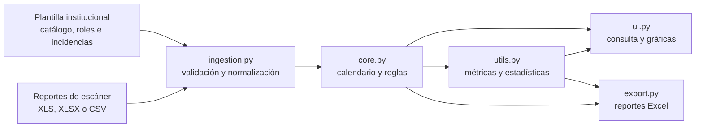

# SGAM · Sistema de Gestión de Asistencias Médicas

**De registros biométricos a un calendario de asistencia auditable.** SGAM es una aplicación de escritorio para Windows que cruza el padrón de internos y residentes, los roles de guardia y las incidencias con reportes de entrada y salida. Normaliza archivos heterogéneos, evalúa cada día con reglas explícitas y entrega vistas y reportes Excel para revisión administrativa.

**Versión 2.3.5** · Python · CustomTkinter · pandas · openpyxl · Matplotlib

**Autores:** Alan Jiménez y Fabrizzio Ramírez · [English documentation](README.en.md)

> SGAM procesa archivos locales. No se conecta directamente a dispositivos biométricos ni sustituye la revisión humana de incidencias o nómina.

## Qué resuelve

| Necesidad | Implementación |
| --- | --- |
| Unir fuentes distintas | Normaliza IDs, fechas y marcas de plantillas Excel, reportes `.xls`/`.xlsx` y CSV genéricos. |
| Explicar cada resultado | Aplica incidencias, guardias A–D, postguardias, festivos, descansos y jornada ordinaria con una prioridad definida. Conserva notas por día. |
| Encontrar errores de captura | Advierte sobre IDs duplicados, formatos inválidos y marcas que no pertenecen al catálogo activo. |
| Revisar y compartir | Muestra calendario por persona, filtros, gráficas y exportaciones individuales, consolidadas y estadísticas. |

La interfaz, el procesamiento y las exportaciones usan `calcular_metricas()` como fuente común para los conteos y porcentajes. Esto evita que un mismo mes aparezca con cifras distintas en pantalla y en Excel.

## Vista de la arquitectura



El motor selecciona el mes predominante entre las marcas de IDs activos y genera **todos los días** de ese mes. Conserva un día adicional de marcas para evaluar las salidas de guardias que cruzan el fin de mes.

## Inicio rápido

Requiere Windows y Python con Tk/Tcl. Para ejecutar desde el código fuente:

```powershell
git clone https://github.com/fabrizzio2901/SGAM.git
cd SGAM
py -m venv .venv
.\.venv\Scripts\Activate.ps1
python -m pip install -r requirements.txt
python main.py
```

Si PowerShell no permite activar el entorno, puedes ejecutar `.\.venv\Scripts\python.exe` en lugar de `python` en los últimos dos comandos. El archivo `SGAM_Proyecto_1.2.py` es un acceso compatible al mismo inicio; `main.py` es el punto de entrada recomendado.

### Prueba con datos ficticios

```powershell
python examples/generate_demo.py
```

El comando crea `demo_output/demo_plantilla.xlsx` y `demo_output/demo_scanner.xlsx` con **dos personas ficticias** y marcas de abril de 2026. En la aplicación:

1. Carga `demo_plantilla.xlsx` como plantilla maestra.
2. Carga `demo_scanner.xlsx` como reporte de escáner.
3. Elige la letra inicial A y pulsa **Procesar Asistencias**.
4. Explora el calendario, los filtros y la exportación a Excel.

La demostración usa jornadas ordinarias entre semana: los sábados sin asignación aparecen como **No laborable** y los domingos tienen un descanso explícito. Las pruebas automatizadas cubren también la prioridad de guardias y descansos. El generador se detiene si los archivos de salida ya existen para evitar sobrescribir datos.

## Contrato de entrada

La plantilla vacía [Plantilla SGAM V2 sin datos.xlsx](Plantilla%20SGAM%20V2%20sin%20datos.xlsx) contiene las siete hojas admitidas. Las primeras cinco son obligatorias:

| Hoja | Columnas mínimas |
| --- | --- |
| `1_Catalogo_Personal` | `ID`, `Nombre completo`, `Estatus`, `Tipo de personal` |
| `2_Rol_Guardias` | `ID`, `Rotación` |
| `3_Registro_Incidencias` | `ID`, `Ausencia Justificada`, `Fecha Inicio`, `Fecha Termino` cuando tiene registros |
| `4_Vacaciones` | Igual que incidencias |
| `5_Rotaciones` | Igual que incidencias |
| `6_Dias_Festivos` (opcional) | Motivo y fecha en las dos primeras columnas |
| `7_Descansos` (opcional) | `ID`, `Dia` y fecha opcional |

El catálogo admite universidad, especialidad, subespecialidad, alta especialidad, período de ingreso y foto. Los IDs numéricos equivalentes se unifican; por ejemplo, `00123` y `123.0` se interpretan como `123`. Los residentes R1–R5 se reconocen como activos. El rol A–D determina el grupo de guardia; una rotación vacía se evalúa como jornada ordinaria entre semana.

Para un reporte genérico `.xlsx` o `.csv`, usa las columnas `ID`, `Fecha`, `Entrada` y `Salida`. También se admiten matrices ZKTeco y reportes de excepciones `.xls`/`.xlsx`. Si una guardia termina al día siguiente, incluye esa salida en el archivo de origen.

## Reglas y métricas

La evaluación sigue este orden: **incidencia registrada (incluida rotación) → guardia → postguardia → festivo → descanso explícito → fin de semana sin asignación → jornada ordinaria**. Un sábado o domingo sin turno ni incidencia asignada es **No laborable**, nunca Falta; una marca biométrica aislada en ese día se anota para revisión, sin convertirla en turno asignado. En festivos y descansos explícitos con marcas se evalúa la asistencia; una falta de guardia revoca la postguardia siguiente. Los horarios y tolerancias actuales están en `core.py` y `ingestion.py`; la interfaz no edita reglas ni carga una hoja `1_Reglas_ID`.

| Indicador | Definición |
| --- | --- |
| Asistencias | `ASISTENCIA + GUARDIA + POST_GUARDIA` |
| Faltas totales | `FALTA + FALTA_GUARDIA` |
| Días evaluados | Asistencias + retardos + faltas totales |
| % asistencia | Asistencias / días evaluados × 100 |
| % presencia física | (`ASISTENCIA + GUARDIA + RETARDO`) / días evaluados × 100 |

Vacaciones, permisos, festivos, descansos y días no laborables quedan fuera del denominador de desempeño. En Excel, **NL** (No laborable) y **Fe** (Festivo) tienen celdas y recuentos separados; la leyenda usa rellenos de celda para mostrar sus colores. La gráfica de distribución del calendario sí muestra todos los días, por lo que sus porcentajes tienen otra base.

## Calidad y empaquetado

```powershell
python -m unittest discover -s tests -v
python build_exe.py
```

Las pruebas verifican métricas compartidas, hojas de estadísticas y descansos individuales, genéricos y puntuales frente a las guardias. `build_exe.py` usa PyInstaller y genera `dist/SGAM.exe` en Windows. El ejecutable es un artefacto local: el repositorio contiene el código y las instrucciones para compilarlo.

| Archivo | Responsabilidad |
| --- | --- |
| `ingestion.py` | Lectura, validación y normalización |
| `core.py` | Reglas de asistencia, calendario y métricas |
| `ui.py` | Interfaz, calendario y análisis visual |
| `export.py`, `utils.py` | Reportes y estadísticas Excel |
| `app_info.py`, `main.py` | Versión y arranque |
| `tests/` | Pruebas de regresión |

## Alcance y datos

SGAM es una herramienta de apoyo administrativo. No hay en este repositorio evidencia de integración en producción, validación clínica, precisión medida sobre datos reales o ahorro de tiempo cuantificado. Las decisiones de asistencia deben verificarse contra las políticas de cada institución.

El repositorio actual incluye una plantilla vacía y un generador de datos ficticios. Mantén fuera de Git los reportes biométricos, padrones llenos y exportaciones; `.gitignore` excluye esos archivos. Si clonas una revisión histórica del repositorio, revisa sus archivos antes de compartirlos: versiones anteriores incluyeron muestras institucionales.
